# Turtle patterns

Generative patterns and seamless fabric repeats drawn with Python's standard-library `turtle` module.
The scripts need nothing beyond Python; the notebooks need matplotlib.

## Notebooks

Ten of the patterns as Jupyter notebooks, from a rosette of squares to threads in a flow field. Each
one builds its pattern in steps: the code split into short explained cells, a picture after each
step, and things to try at the end. The fabric notebooks also show their tile repeated 2 × 2.
GitHub shows the notebooks with their pictures, so you can read them without running anything.

| | | | | |
| :-: | :-: | :-: | :-: | :-: |
| [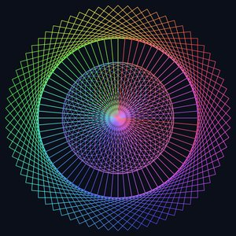](01_rosette.ipynb)<br>[Rosette](01_rosette.ipynb) | [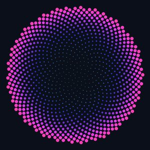](02_phyllotaxis.ipynb)<br>[Phyllotaxis](02_phyllotaxis.ipynb) | [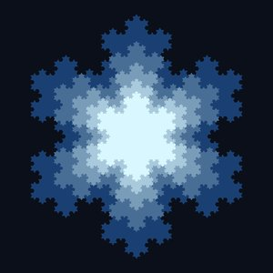](03_koch_snowflake.ipynb)<br>[Koch snowflake](03_koch_snowflake.ipynb) | [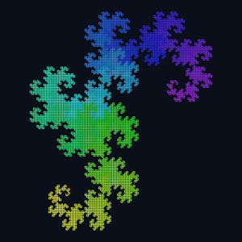](04_dragon_curve.ipynb)<br>[Dragon curve](04_dragon_curve.ipynb) | [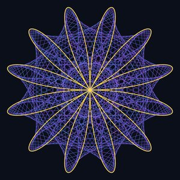](05_maurer_rose.ipynb)<br>[Maurer rose](05_maurer_rose.ipynb) |
| [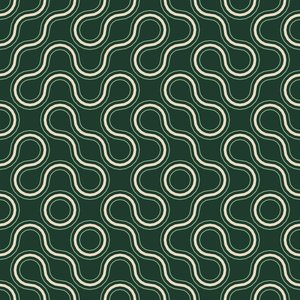](06_fabric_truchet.ipynb)<br>[Truchet ribbons](06_fabric_truchet.ipynb) | [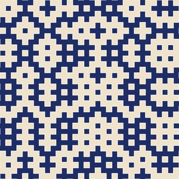](07_fabric_hitomezashi.ipynb)<br>[Hitomezashi](07_fabric_hitomezashi.ipynb) | [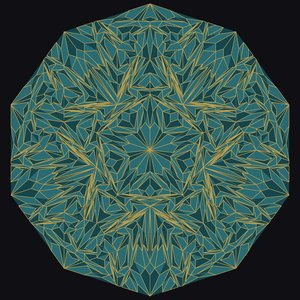](08_fabric_penrose.ipynb)<br>[Penrose medallion](08_fabric_penrose.ipynb) | [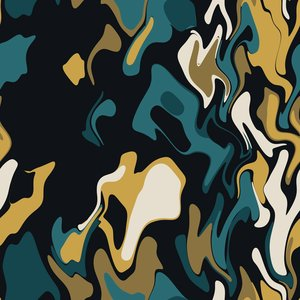](09_fabric_marbled.ipynb)<br>[Marbled paper](09_fabric_marbled.ipynb) | [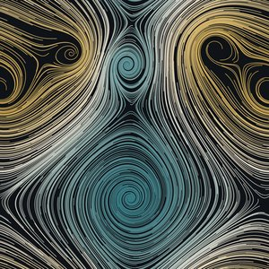](10_fabric_vortices.ipynb)<br>[Vortices](10_fabric_vortices.ipynb) |

To run them yourself:

```bash
pip install -r requirements.txt
```

```bash
jupyter lab
```

The standard `turtle` module needs a Tk window, which a notebook doesn't have. So the notebooks
draw with [`nbturtle.py`](nbturtle.py), a stand-in that takes the same commands (`forward`, `left`,
`circle`, `goto`, `begin_fill`, `dot`, …) and shows the drawing inline. `render(draw, width, height,
background)` is the notebook twin of `common.run`. It draws the same picture as the scripts, and
`canvas.save(path, dpi=288)` writes a print-size tile.

## Patterns

| | Script | Pattern |
| --- | --- | --- |
|  | `rosette.py` | 72 rotated squares with a cycling hue, plus a ring of circles in the core |
|  | `phyllotaxis.py` | 1000 seeds placed at the golden angle, like a sunflower head |
|  | `dragon_curve.py` | order-13 dragon curve, colored along its length |
| 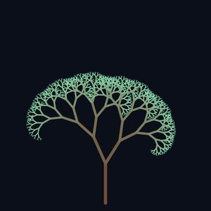 | `fractal_tree.py` | asymmetric binary tree, bark at the trunk, mint at the tips |
|  | `maurer_rose.py` | Maurer rose (n=6, d=71) with the underlying rose outlined in gold |
|  | `koch_snowflake.py` | five nested, filled Koch snowflakes |

## Fabric repeats

Most tiles are 800 px, the tables note the exceptions, and every motif period divides its tile, so the tiles repeat seamlessly in both directions.

| | Script | Fabric |
| --- | --- | --- |
| 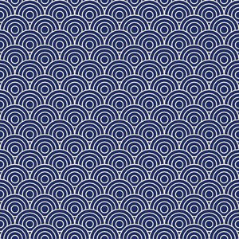 | `fabric_seigaiha.py` | Japanese ocean-wave scallops, cream on indigo |
|  | `fabric_truchet.py` | Truchet ribbons, seeded random arcs, sand on moss green |
| 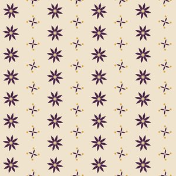 | `fabric_blockprint.py` | half-drop block print, plum flowers and sprigs on sand |
| 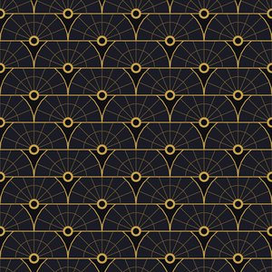 | `fabric_deco_fans.py` | Art Deco fans, gold on near-black |
| 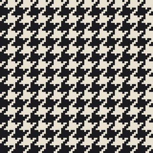 | `fabric_houndstooth.py` | houndstooth generated from the 2/2 twill weave rule, charcoal on ivory |
| 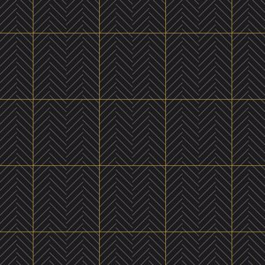 | `fabric_herringbone.py` | herringbone suiting with a gold windowpane check |
| 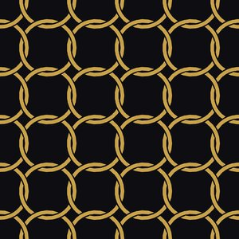 | `fabric_chainlink.py` | interlocking gold rings woven over and under, on near-black |
| 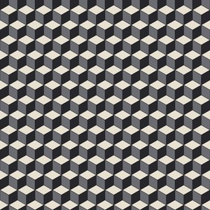 | `fabric_tumbling_blocks.py` | isometric cubes in ivory, graphite and charcoal |
| 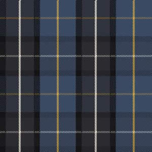 | `fabric_tartan.py` | charcoal, slate and ivory tartan with one gold line, twill-woven crossings |
| 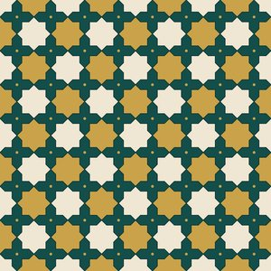 | `fabric_star_cross.py` | Islamic eight-pointed star and cross, ivory and gold on teal |
| 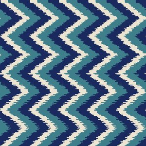 | `fabric_ikat.py` | chevron ikat, indigo, ivory and teal, feathered thread by thread |
| 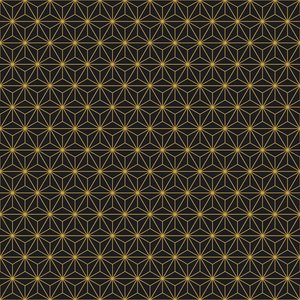 | `fabric_asanoha.py` | sashiko hemp-leaf grid, gold on charcoal |

## Generated patterns

These are not reproductions of a named motif. Each comes from a rule plus a seed, so changing the
seed or a constant gives a tile nobody has seen. No guarantee that nothing similar exists.

| | Script | Pattern |
| --- | --- | --- |
| 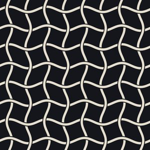 | `fabric_sineweave.py` | wavy ivory ribbons in a true over-under basket weave |
| 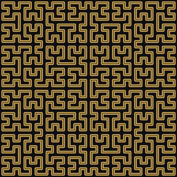 | `fabric_moore.py` | one closed gold thread filling a 32 x 32 grid, a digital meander |
| 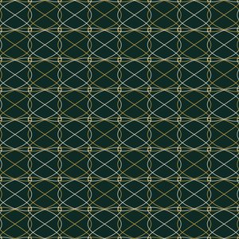 | `fabric_lissajous.py` | Lissajous knots overlapping into lace, gold and ivory on green |
| 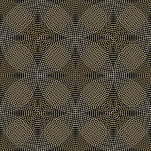 | `fabric_moire.py` | concentric rings interfering into op-art blooms |
| 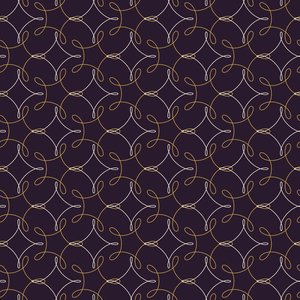 | `fabric_spirolace.py` | two spirograph roses alternating into lace on plum |

## Thread-drawn

The ones that look like cloth rather than diagrams. Hundreds of fine strands or contour lines
on ink, in gold, ivory and teal, all wrapping across the tile edges.

| | Script | Pattern |
| --- | --- | --- |
| 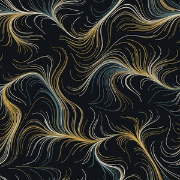 | `fabric_current.py` | threads following a periodic flow field, marbled currents |
| 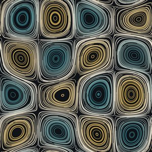 | `fabric_eddies.py` | threads circling a checkerboard of whirlpools, teal one way, gold the other |
| 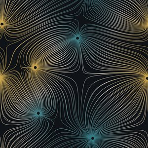 | `fabric_magnetic.py` | field lines between six magnetic poles, like iron filings |
| 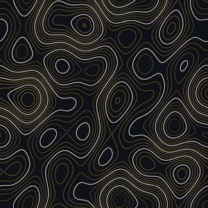 | `fabric_contours.py` | topographic contour map of a periodic landscape |
|  | `fabric_marbled.py` | mathematical paper marbling, drops combed into feathers |
| 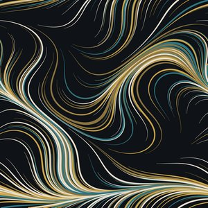 | `fabric_brush.py` | long tapered brush strokes along a slow field |
|  | `fabric_vortices.py` | threads spiraling around five point vortices, galaxies on a torus |
| 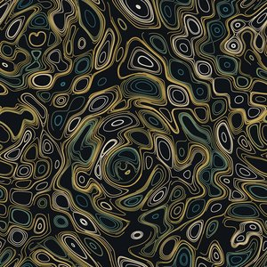 | `fabric_ripples.py` | threads riding the crests of interfering ripples from four sources |
| 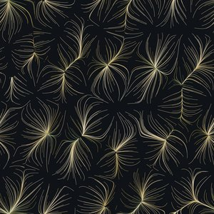 | `fabric_rivers.py` | raindrops running downhill, converging into dandelion-like tufts, one per basin |
| 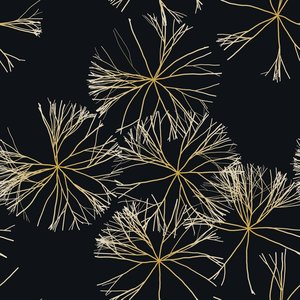 | `fabric_mycelium.py` | radial colonies of branching hyphae, like seed heads on ink |
| 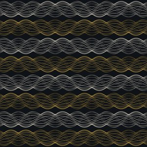 | `fabric_guilloche.py` | engraved guilloche ribbons, bands of phase-shifted sine lines |
| 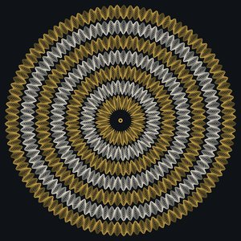 | `fabric_dial.py` | guilloche rosette like a watch face (block) |

## Twenty more, from tiling problems and other mathematics

Seamless unless marked "block", where a self-contained block repeats and its border shows.

| | Script | Pattern |
| --- | --- | --- |
| 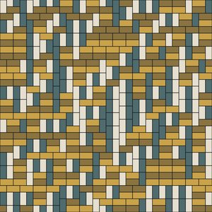 | `fabric_dominoes.py` | random domino tiling of a torus, four colors by orientation and parity |
| 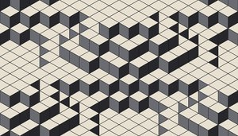 | `fabric_voxels.py` | a landscape of stacked cubes, also a lozenge tiling, 840 x 480 |
| 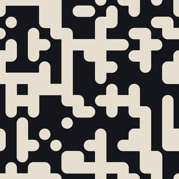 | `fabric_wang.py` | corner-colored Wang tiles melting into rounded two-tone islands |
| 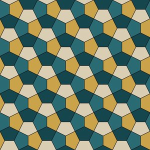 | `fabric_cairo.py` | the Cairo pentagon tiling in four tones |
| 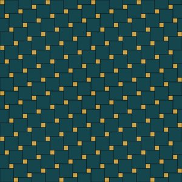 | `fabric_pythagorean.py` | Pythagorean tiling, big and small squares on a skew lattice |
|  | `fabric_penrose.py` | Penrose rhombus medallion from six rounds of deflation (block) |
| 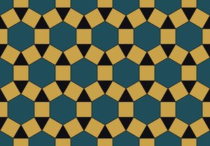 | `fabric_rhombitrihex.py` | hexagons, squares and triangles, the 3.4.6.4 tiling, 800 x 554 |
| 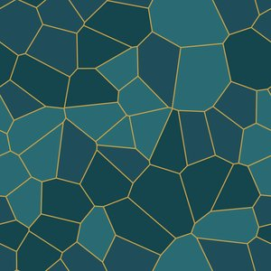 | `fabric_voronoi.py` | Voronoi crackle around seeds on a torus |
| 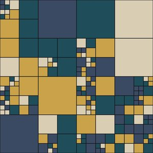 | `fabric_quilt.py` | a square packed with squares via a random quadtree |
| 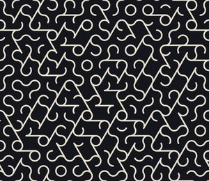 | `fabric_hextruchet.py` | hexagonal Truchet tiles with arcs and bars, 840 x 728 |
| 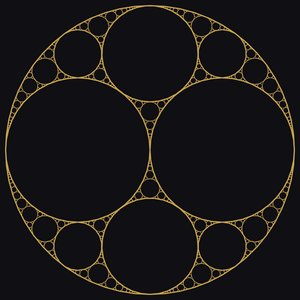 | `fabric_apollonian.py` | Apollonian gasket medallion, gold circles on ink (block) |
| 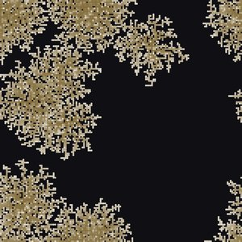 | `fabric_dla.py` | diffusion-limited aggregation coral on a torus |
| 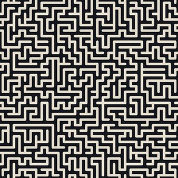 | `fabric_maze.py` | a perfect maze on a torus, drawn as ivory passages |
| 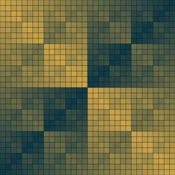 | `fabric_xor.py` | i XOR j on a teal-to-gold gradient (block) |
|  | `fabric_fibonacci_word.py` | Fibonacci word fractal medallion (block) |
|  | `fabric_bubbles.py` | terrazzo of random non-overlapping circles on a torus |
|  | `fabric_hitomezashi.py` | hitomezashi stitching from two random bit strings, two-colored |
|  | `fabric_ulam.py` | Ulam prime spiral, primes in gold (block) |
|  | `fabric_thue_morse.py` | Thue-Morse checkerboard from binary digit parity (block) |
|  | `fabric_trominoes.py` | a 32 x 32 board with one hole tiled by L-trominoes (block) |

## Printing on fabric

Print-on-demand fabric services take a PNG tile at 150 dpi and repeat it across the cloth. A
1600 px tile prints as a 27 cm repeat. For a larger repeat, re-render at a higher resolution;
the source is vector, so lines thicken with it:

```bash
xvfb-run -a python3 fabric_vortices.py --save out/fabric_vortices_3200.png --dpi 288
```

That gives a 3200 px tile, a 54 cm repeat at 150 dpi, with the thinnest lines at about 0.9 mm.
At the 27 cm repeat the thread patterns' lines are about 0.45 mm, the limit of what digital
fabric printing resolves on smooth cloth. Order a test swatch before yardage; gold prints as
ochre and every colour comes out a little duller than on screen.

Stitch a tile 2x2 to check the repeat (needs ImageMagick):

```bash
convert \( out/fabric_truchet.png out/fabric_truchet.png +append \) \( out/fabric_truchet.png out/fabric_truchet.png +append \) -append out/fabric_truchet_repeat.png
```

## Running

Show one in a window (click the window to close it):

```bash
python3 rosette.py
```

Render all of them to `out/*.png` without opening windows (needs `xvfb-run` and `gs`):

```bash
xvfb-run -a python3 render_all.py
```

Each script exposes `draw(turtle)`; `common.py` handles the window, the dark background and the PNG export.
